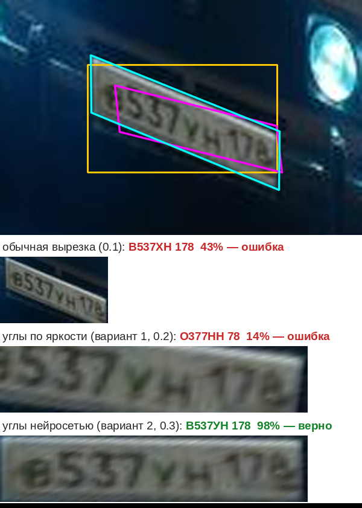

# Номерок 0.3 — разбор проекта

Короткое руководство: что происходит с кадром, по шагам и в каком порядке, где это лежит в коде и откуда взялись модели и данные. Отчёт (HTML-таблица) здесь не разбирается.

В коде те же шаги помечены комментариями `ШАГ 1` … `ШАГ 7`. Найти их можно поиском. Общая схема есть в начале `main.rs`.

## Вся цепочка в одном абзаце

Берём кадр → нейросеть-детектор находит на нём прямоугольники с номерами → каждый номер вырезаем как есть и «выпрямленным»: находим 4 угла таблички и приводим её к ровному прямоугольнику преобразованием перспективы. Углы ищем двумя способами: по яркости (вариант 1) и маленькой нейросетью (вариант 2) → нейросеть-распознаватель читает все вырезки → из её ответа собираем номер по правилам ГОСТ (где буква, где цифра) → из всех прочтений оставляем лучшее → на видео склеиваем кадры одной машины и голосуем → пишем результат.

## Файлы

| файл | что внутри | шаг |
|---|---|---|
| `main.rs` | параметры запуска, порядок шагов (`Ctx::photo`, `Ctx::video_once`, `Ctx::read_all`), выбор лучшего прочтения | 1, 3, 5 |
| `video.rs` | кадры из видео и камер через ffmpeg | 1 |
| `engine.rs` | запуск нейросетей через ONNX Runtime: `Detector` (поиск номеров), `CornerNet` (углы номера), `Reader` (чтение) | 2, 3, 4 |
| `imgops.rs` | простые операции с картинкой: уменьшить, вырезать, нарисовать рамку | 2, 3 |
| `rectify.rs` | поиск 4 углов по яркости (вариант 1), выпрямление номера, проверка углов | 3 |
| `plate.rs` | форматы номеров РФ, коды регионов, сборка номера из ответа сети | 4 |
| `track.rs` | видео: одна машина — один номер, голосование по кадрам | 6 |
| `report.rs` | запись CSV/JSONL/HTML | 7 |

## Пошагово

### ШАГ 1. Кадр

- **Фото:** `main.rs`, `load_image`. Файл открывается библиотекой `image`. Поворот из EXIF учитывается: снимок с телефона не окажется лёжа.
- **Видео и камеры:** `video.rs`, `Frames::open` / `next_frame`. Запускаем `ffmpeg`, он декодирует любой формат и RTSP-поток и отдаёт кадры картинками в канал. Анализируется `--fps` кадров в секунду (по умолчанию 6). Если камера отвалилась, программа переподключается сама: `Ctx::video`.

### ШАГ 2. Где на кадре номера (детектор)

- **Код:** `engine.rs`, `Detector::detect`. Подготовка кадра лежит в `imgops::letterbox_chw`: кадр вписывается в квадрат 640×640 с серыми полями, так же как при обучении YOLO.
- **Модель:** YOLOv9-t из проекта **open-image-models** (MIT). Это готовый детектор номеров, его обучил автор проекта. Мы его не меняли. Подавление дублей (NMS) встроено в модель, поэтому на выходе сразу чистый список рамок `x1, y1, x2, y2, уверенность`. Рамки слабее `--det-conf` (0,3) отбрасываются.
- **Важно:** рамка всегда прямоугольная и «ровная». Если номер снят под углом, внутрь попадают кусок бампера и наклонённая табличка. С этим разбирается шаг 3.

### ШАГ 3. Вырезка номера: обычная и выпрямленная

Все вырезки делаются в `main.rs`, `Ctx::read_all`.

**3а. Обычная** (`imgops::crop`) — прямоугольник детектора с запасом 2 % по ширине и 6 % по высоте. Так работала версия 0.1.

**3б. Выпрямленная** (`rectify.rs`). **Приводим номер к нормализованному виду преобразованием перспективы — вот здесь:**

- углы таблички на кадре ищут два способа: `rectify::find_corners` (вариант 1, по яркости) и `CornerNet::find` в `engine.rs` (вариант 2, нейросеть), см. ниже;
- `rectify::homography` по 4 парам точек «угол на кадре → угол ровного прямоугольника» считает матрицу преобразования перспективы 3×3. Это система из 8 уравнений, решаем её методом Гаусса;
- `rectify::warp` по этой матрице вырезает табличку из **исходного** кадра, не из уменьшенной копии, в ровный прямоугольник 297×64. Каждая точка — среднее нескольких выборок, чтобы мелкий текст не рассыпался.

**Вариант 1: как `find_corners` находит углы.** Нейросети здесь нет, всё считается по яркости внутри рамки детектора с запасом:

1. Область переводится в серое и масштабируется до ширины 220 точек.
2. Ищем символы (`ink_mask`, `components`, `looks_like_char`). Символ — тёмное пятно на светлом фоне. Точка считается «чернилами», если она темнее среднего по окну вокруг (адаптивный порог через интегральное изображение). Соседние такие точки собираются в пятна, и остаются только пятна размером и формой с символ. Для синих номеров полиции (светлые знаки на тёмном) то же самое повторяется наоборот.
3. **Наклон строки** (`baseline`). Низы символов лежат на одной прямой. Перебираем пары пятен, через каждую пару проводим прямую и считаем, сколько ещё пятен на ней лежит (метод RANSAC). Побеждает прямая с наибольшим числом символов.
4. **Наклон вертикалей** (`best_shear`). При съёмке сбоку вертикали символов перестают быть перпендикулярны строке. Перебираем наклон от −40° до +40°. Правильный тот, при котором символы в сумме получаются самыми «узкими».
5. **Края таблички.** Теперь известны направление строки и вертикалей, высота цифр и где строка начинается и кончается.
   - Верх и низ ставятся по высоте цифр. Поле над цифрами — 0,40 их высоты, под ними — 0,34. Эти пропорции замерены на обучающих вырезках AUTO.RIA (скрипт `eval/measure_layout.py`), поэтому выпрямленная вырезка выглядит так же, как те, на которых учился распознаватель.
   - Левый и правый край ищутся по перепаду «светлый фон таблички → тёмная рамка или кузов». Подсказкой служит раскладка номера РФ: до первой буквы около 0,17 длины «А123ВС», после последней около 0,48 (там код региона).
   - В конце добавляется небольшая поправка: обучающие вырезки чуть шире самой таблички, слева на 3,6 %, справа на 1,9 % (`eval/bias.py`).
6. **Проверка** (`sane`). Четырёхугольник должен быть выпуклым, разумного размера и рядом с рамкой детектора. Если что-то не так, `find_corners` возвращает «не нашёл», и остаётся обычная вырезка.

Вариант 1 пропускает почти квадратные рамки (двухстрочные таблички мото и некоторых прицепов): для них остаётся обычная вырезка.

**Вариант 2: углы находит маленькая нейросеть** (`engine.rs`, `CornerNet::find`; модель `models/corners.onnx`, ≈0,7 млн параметров).

1. **Вход.** Берём рамку детектора с запасом: 15 % по ширине и 50 % по высоте (`rectify::net_region`). Вырезаем эту область из кадра, переводим в серое и сжимаем до 192×64.
2. **Сеть.** 9 свёрточных слоёв постепенно уменьшают картинку до 6×2 клеток по 128 признаков. Потом два полносвязных слоя выдают **8 чисел**: x и y четырёх углов (левый верх, правый верх, правый низ, левый низ) в долях области.
3. **Назад в кадр.** Доли переводятся в точки кадра. Проверка `rectify::sane` та же, что у варианта 1: выпуклый четырёхугольник разумного размера рядом с рамкой.
4. **Выпрямление** — те же `homography` и `warp`.

Все номера кадра проходят через сеть одной пачкой. Вместе с чтением лишней вырезки это около 20 мс на номер на 2 ядрах. Порог по форме рамки здесь мягче, чем у варианта 1: сильно наклонённый номер даёт почти квадратную рамку, а именно такие номера выпрямление спасает чаще всего.

**Как сеть обучена** (скрипты в `eval/`, порядок — в `eval/README.txt`):

- **Данные:** 6 000 фото машин из обучающей части AUTO.RIA Numberplate Dataset 2023-03-06 (CC BY 4.0), где у номера размечены 4 угла.
- **Подготовка (`gen_corner_ds.py`, `synth_lib.py`).** В размеченные углы вклеивается вырезка российского номера из обучающей части OCR-датасета. Потом кадр поворачивается до ±20°, смотрится сбоку (скос, сжатие, лёгкая перспектива), уменьшается до ширины номера 50–230 точек, вставляется в кадр размером с камерный, жмётся в JPEG 35–90. Плюс яркость, шум, размытие.
- **Рамка — от настоящего детектора.** На каждом снимке запускается наш детектор, и вход сети строится от его рамки, а не от идеальной. Поэтому сеть привыкла к тем рамкам, которые увидит в программе. Вышло 15 606 примеров, ещё 13 % пропущены: детектор не нашёл номер.
- **Обучение (`train_corners.py`).** PyTorch, 30 эпох, около 25 минут на 2 ядрах процессора. Ошибка считается в точках входа 192×64. При обучении рамка ещё слегка «дрожит», меняются яркость и контраст, бывают пятна и инверсия.
- **Что сеть выучила.** Углы — это края той же вырезки, на которых учился распознаватель, а не края металлической таблички. Поэтому выпрямленная вырезка похожа на обучающие вырезки распознавателя.

Почти квадратные двухстрочные таблички (мото, некоторые прицепы) — слабое место. В открытых российских данных их нет вообще, поэтому выпрямление для них не проверено. Страховка (шаг 5) здесь особенно важна.

### ШАГ 4. Чтение символов и проверка формата РФ

- **Код:** `engine.rs`, `Reader::read`. Все вырезки кадра (обычные и оба вида выпрямленных) читаются одной пачкой. Каждая сжимается до 128×64. Сеть выдаёт 10 позиций, и для каждой — вероятности 37 знаков: 0–9, A–Z и «_» (пусто).
- **Модель:** CCT-XS из проекта **fast-plate-ocr** (MIT), дообученная на российских номерах AUTO.RIA: 49 383 снимка для обучения, 4 894 для контроля, 2 846 для теста. Обучение — 3 эпохи, около 7 минут. Добавлялись искажения: повороты, перспектива, шум, размытие, обрезка. На 2 845 тестовых номерах без единой ошибки читается 99,7 % (исходная модель — 63 %).
- **Почему латиница.** Сеть знает латинский алфавит. В номерах РФ разрешены только 12 букв, которые пишутся одинаково в обеих азбуках: А В Е К М Н О Р С Т У Х. Поэтому внутри программы номер хранится латиницей (`A123BC77`), а показывается кириллицей (`plate::to_cyr`). `--find` принимает и то и другое.
- **Сборка номера:** `plate.rs`, `decode_shaped`. Брать «самый вероятный знак на каждой позиции» нельзя: сеть иногда путает О и 0, В и 8. Поэтому перебираем допустимые шаблоны номеров РФ и берём тот, у которого суммарная вероятность выше. Если по шаблону здесь буква, «0» превращается в «О». Ещё проверяется код региона: несуществующий трёхзначный регион снижает уверенность.

**Почему у такси, полиции и других свой формат.** Это не придумано программой, так написано в ГОСТ Р 50577-2018, и так ГИБДД выдаёт номера:

| вид | пример | порядок |
|---|---|---|
| легковые, грузовые | А123ВС 77 | буква, 3 цифры, 2 буквы, регион |
| такси (жёлтые), автобусы | АВ123 77 | 2 буквы, 3 цифры, регион |
| прицепы | АВ1234 77 | 2 буквы, 4 цифры, регион |
| полиция (синие) | А1234 77 | буква, 4 цифры, регион |
| мотоциклы, военные, тракторы | 1234 АВ 77 | 4 цифры, 2 буквы, регион |
| транзитные | АВ123С 77 | 2 буквы, 3 цифры, буква, регион |

В коде шаблон записан коротко: `L` — буква, `D` — цифра, например `LDDDLLDD` = А123ВС77. Обычные легковые номера встречаются гораздо чаще, поэтому при сомнении выигрывают они (поле `prior`).

Если на объекте бывают только легковые машины, лишние виды можно выключить: `--formats легковые` или `--formats легковые,такси`. Тогда программа не будет «натягивать» на номер, например, полицейский формат.

### ШАГ 5. Страховка: из всех прочтений берём лучшее

`main.rs`, `better`. У каждого номера до трёх прочтений: обычная вырезка, выпрямленная по яркости, выпрямленная сетью. Правило простое:

- номер допустимого формата РФ лучше «не похожего на номер»;
- если оба допустимые или оба нет, берём тот, где уверенность выше. Уверенность — это вероятность самого сомнительного знака.

Выпрямление только добавляет варианты и ничего не отнимает. Режим меняется параметром `--rectify`:

- `auto` (по умолчанию) — все три вырезки;
- `net` — обычная и по сети;
- `classic` — обычная и по яркости, как в 0.2;
- `off` — только обычная, как в 0.1;
- `on` — всегда выпрямленная: по сети, а если сеть не нашла углы — по яркости.

Свою модель углов можно подложить файлом `models\corners.onnx` рядом с программой или параметром `--corners`.

### ШАГ 6. Только видео: одна машина — одна запись

`track.rs`:

- `Tracker::update` связывает номер на новом кадре с номером на прошлых: по перекрытию рамок, предсказанию движения и совпадению текста.
- `vote` собирает итог по всем кадрам машины. Сначала выбирается формат, набравший больше веса, потом каждый знак голосованием. Вес кадра — это уверенность × размер номера: мелкие кадры весят меньше.
- Машина выдаётся, когда номер не виден `--gap` секунд (уехала) или когда стоящая машина 4+ кадра читается уверенно (`Ctx::video_once`).

### ШАГ 7. Запись

`report.rs`. Пишет `plates.csv` для Excel и `plates.jsonl`. В JSONL есть рамка детектора `bbox`, углы `corners`, какая вырезка выбрана (`crop_kind`). Ещё там список `variants`: что дала каждая вырезка (номер, «сырое» прочтение `raw`, уверенность, подошёл ли формат, углы). По нему видно, какой способ выручает на вашей камере. Отсюда же берутся данные для дообучения, см. ниже.

## Откуда модели и данные

| что | откуда | лицензия |
|---|---|---|
| детектор номеров YOLOv9-t | [open-image-models](https://github.com/ankandrew/open-image-models) | MIT |
| распознаватель CCT-XS | [fast-plate-ocr](https://github.com/ankandrew/fast-plate-ocr) | MIT |
| дообучение распознавателя | AUTO.RIA Numberplate OCR RU 2021-09-01, [nomeroff.net.ua/datasets](https://nomeroff.net.ua/datasets/) | CC BY 4.0 |
| сеть углов (вариант 2) | наша, обучена на AUTO.RIA Numberplate Dataset 2023-03-06 (там же): 6 000 фото из обучающей части, у номера размечены 4 угла | CC BY 4.0 (данные) |
| проверка выпрямления | тот же датасет, 800 других фото из проверочной части | CC BY 4.0 |
| обучение сети углов | [PyTorch](https://pytorch.org), выгрузка в ONNX | BSD |
| запуск нейросетей | [ONNX Runtime](https://onnxruntime.ai) (Microsoft) | MIT |
| видео и камеры | [ffmpeg](https://ffmpeg.org) | LGPL/GPL, ставится отдельно |
| форматы номеров | ГОСТ Р 50577-2018 | — |

**Статьи, если захочется углубиться:**

- YOLOv9 — Wang, Yeh, Liao. *YOLOv9: Learning What You Want to Learn Using Programmable Gradient Information*, 2024. [arXiv:2402.13616](https://arxiv.org/abs/2402.13616)
- CCT (основа распознавателя) — Hassani и др. *Escaping the Big Data Paradigm with Compact Transformers*, 2021. [arXiv:2104.05704](https://arxiv.org/abs/2104.05704)
- DyT (слои tanh вместо нормализации в распознавателе) — Zhu и др. *Transformers without Normalization*, 2025. [arXiv:2503.10622](https://arxiv.org/abs/2503.10622)
- RANSAC — Fischler, Bolles. *Random Sample Consensus*, Communications of the ACM, 1981.
- Гомография — Hartley, Zisserman. *Multiple View Geometry in Computer Vision*, гл. 4 (алгоритм DLT).
- Адаптивный порог через интегральное изображение — Bradley, Roth. *Adaptive Thresholding Using the Integral Image*, 2007.
- Поиск углов номера нейросетью (идея варианта 2) — Silva, Jung. *License Plate Detection and Recognition in Unconstrained Scenarios* (WPOD-Net), ECCV 2018. Датасет с углами CCPD — Xu и др., ECCV 2018. LPRNet (выравнивание внутри сети) — Zherzdev, Gruzdev, 2018, [arXiv:1806.10447](https://arxiv.org/abs/1806.10447).

## Что измерено и насколько этому верить

Своих записей с камеры нет, поэтому проверка шла на открытых данных (скрипты и порядок действий — в папке `eval/`). Для проверки взяты **800 фото, которые не участвовали ни в настройке варианта 1, ни в обучении сети**. В них, точно в размеченные 4 угла, вклеивались российские номера с известным текстом из тестовой части. Потом кадр поворачивался или смотрелся «сбоку», уменьшался до ширины номера 70–200 точек, вставлялся в кадр размером с камерный и пережимался в JPEG. Всего 2 400 снимков, детектор нашёл номер на 2 183.

| снимки | 0.1, обычная вырезка | 0.2, вариант 1 | 0.3, варианты 1 и 2 |
|---|---|---|---|
| номер почти прямо | 90,8 % | 94,4 % | 98,4 % |
| кадр повёрнут на 5–15° | 85,3 % | 91,0 % | 97,8 % |
| вид сбоку (скос 8–24°) | 81,4 % | 86,9 % | 97,4 % |
| **всего, 2 183 номера** | **86,0 %** | **90,9 %** | **97,9 %** |

Это доля номеров, прочитанных целиком без ошибок. Ошибок стало в 6,5 раза меньше, чем в 0.1. Относительно обычной вырезки исправился 261 номер, испортился 1 (у варианта 1 — 109 и 2). С одной сетью без варианта 1 (`--rectify net`): 97,8 %, исправилось 258, испорчено 0.

- **Углы находятся** почти у всех номеров (у варианта 1 — у 74 %).
- **Средняя ошибка угла** — 0,05 высоты таблички. У варианта 1 — 0,15, у рамки детектора — 0,41.
- **Скорость** (2 ядра, 300 снимков): без выпрямления 34 с, с вариантом 1 — 35 с, с обоими — 42 с, то есть +22 %, около 0,14 с на фото. Видео — около 8–9 кадров в секунду анализа.

**Проверка на настоящих табличках, без вклейки.** Здесь те же 800 фото с их собственными номерами, только кадр наклонялся. Это важно: обучение и первая проверка шли на вклеенных номерах, и сеть могла привыкнуть к следам вклейки.

- **Точность углов.** Ошибка до краёв таблички: у сети 0,08–0,09 высоты, у варианта 1 — 0,18–0,20. Сеть точнее в 91–93 % случаев.
- **Чтение.** Большинство номеров там украинские, правила формата РФ к ним не подходят, поэтому сравнивалось «сырое» прочтение. Эталоном служило прочтение того же фото без наклона. Наклонённые копии 187 номеров читаются верно: обычная вырезка — 81–82 %, вариант 1 — 83–85 %, вырезка по сети — 91–92 %.

**Оговорки:**

- **Наклон.** Сцены настоящие, но наклон добавлен искусственно, а снимки AUTO.RIA — дневные фото из объявлений.
- **Не проверены** ночь, ИК-подсветка, грязь и большая скорость. Сеть обучена только на дневных фото.
- **Двухстрочные таблички** не проверены: в открытых российских данных их нет.
- **Оптимистичные цифры.** В данных AUTO.RIA одна машина может попасть и в обучение распознавателя, и в его тест, поэтому 99,7 % у распознавателя — скорее оптимистичная цифра. Синтетическая проверка выпрямления тоже, скорее всего, оптимистична: номера вклеены тем же способом, что и при обучении. Проверка на настоящих табличках честнее.
- **Своя камера.** Окончательная проверка нужна на записях с вашей камеры: 200–500 кадров, которые надо проверить глазами.

## Что дальше

- **Дообучить сеть углов под свою камеру.** Когда появятся записи, в `plates.jsonl` у каждого номера будут углы и прочтения всех вырезок. Кадры, где выпрямленная вырезка прочитана уверенно и совпала с проверенным глазами номером, — готовая разметка. Сотня-другая таких кадров добавляется к обучающим примерам, и `train_corners.py` запускается ещё раз (около получаса на обычном компьютере).
- **Сеть для ночи и ИК.** Нужны ночные записи. Подход тот же, детектор по-прежнему не трогаем.
